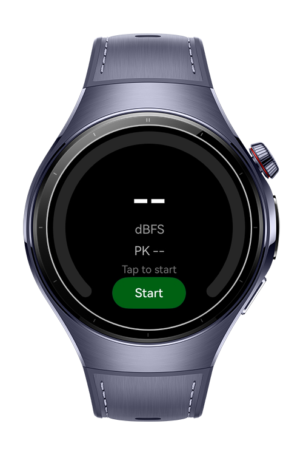
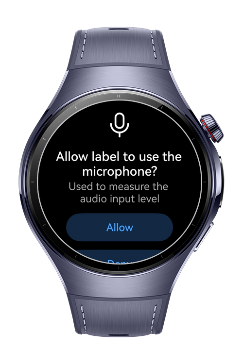
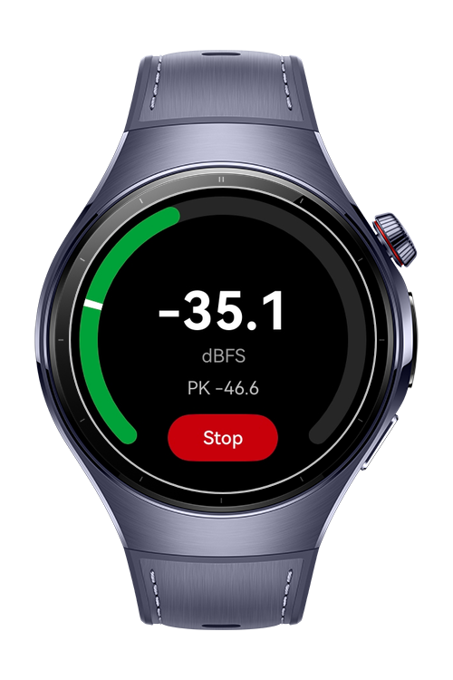
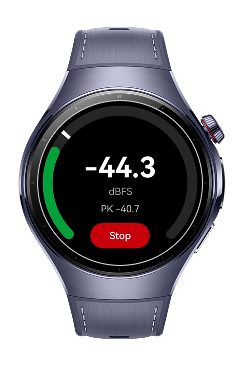

> **Note:** To access all shared projects, get information about environment setup, and view other guides, please visit [Explore-In-HMOS Index](https://github.com/Explore-In-HMOS/hmos-index).

# How to Implement Peak Hold

A simple ArkTS sample app for HarmonyOS smart watches. It measures the microphone input level in real time and shows it on a round gauge.

The app reads raw PCM frames from the microphone and calculates the RMS level of each frame in dBFS. It smooths that value with an Exponential Moving Average (EMA) and keeps the highest level from each UI update interval (peak-hold). Measurement and UI scaling are separated, so you can change how the meter looks without touching the audio math.

# Preview

<div>




</div>

# Use Cases

- `Noise Monitoring` See how loud the environment is on your wrist.
- **`Voice and speech feedback`** Check whether you are speaking too quietly or too loudly, for example during practice or presentations.`
- **`Recording check`** Confirm that the microphone is picking up sound before you start a recording.
- **`Sound-reactive features`** Use the level as an input for workouts, games or alerts that respond to claps, whistles or voice.
- **`Learning reference`** Use it as a starting point for audio metering, smoothing and peak detection in ArkTS.

# Tech Stack

- **Languages**: ArkTS
- **Frameworks**: HarmonyOS SDK 5.1.0(18)
- **Tools**: DevEco Studio Vers 5.1.0.842
- **Libraries**:
  - `@kit.ArkUI`
  - `@kit.SensorServiceKit`
  - `@kit.BasicServicesKit`
  - `@kit.PerformanceAnalysisKit`

# Directory Structure

```
entry/src/main/
├── ets/
│   ├── meter/
│   │   ├── LevelMeter.ets          # Measurement: RMS dBFS, EMA smoothing, interval peak-hold
│   │   ├── MeterScale.ets          # UI scaling: dBFS to fraction, color and label
│   │   └── AudioMeterService.ets   # AudioCapturer setup, feeds PCM frames into LevelMeter
│   └── pages/
│       └── Index.ets               # Round wearable UI (Canvas ring, readouts, Start/Stop)
├── resources/base/element/
│   └── string.json                 # mic_reason string for the permission dialog
└── module.json5                    # MICROPHONE permission and wearable device type
```

# Constraints and Restrictions

* **`Not calibrated`** Readings are dBFS, relative to the device's digital full scale. They are not dB SPL, and converting them needs a per-device calibration offset.
* **`Mono input only`** The meter assumes mono S16LE audio. Stereo input needs de-interleaving or a separate level per channel.
* **`RMS convention`** A full-scale sine wave reads about -3.01 dBFS. Add +3.01 dB if you need AES-17 style readings.
* **`Buffer-dependent resolution`** The level is calculated per capture buffer, so its time resolution depends on the buffer size the system delivers.
* **`System audio processing`** Automatic gain control or noise suppression on the device can change the absolute values.
* **`Peak is frame RMS, not sample peak`** The white tick shows the highest frame RMS in each 100 ms interval, not the highest individual sample.
* **`Foreground only`** Measuring stops when the page is hidden, so there is no background monitoring.
* **`Microphone permission required`** If the user denies it, the app can't measure anything.

## Supported Devices

- Huawei Watch 5`

## Permissions

ohos.permission.MICROPHONE

# License

**How to Implement Peak Hold** is distributed under the terms of the MIT License. See the [LICENSE](LICENSE) for more information.
